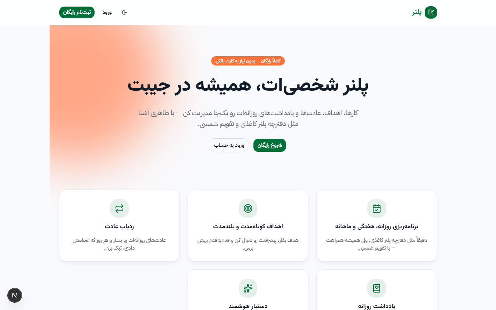
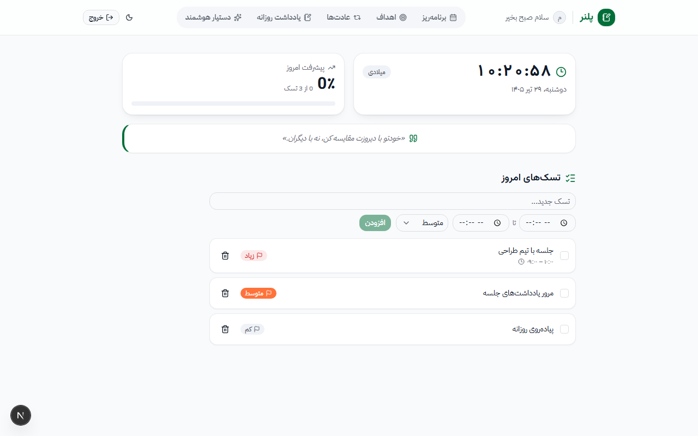
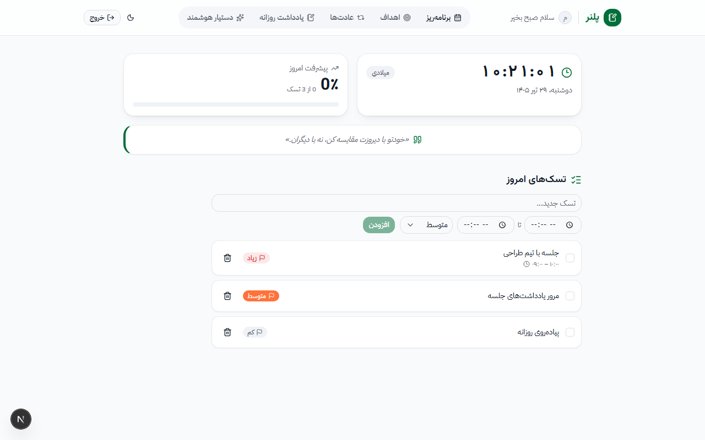
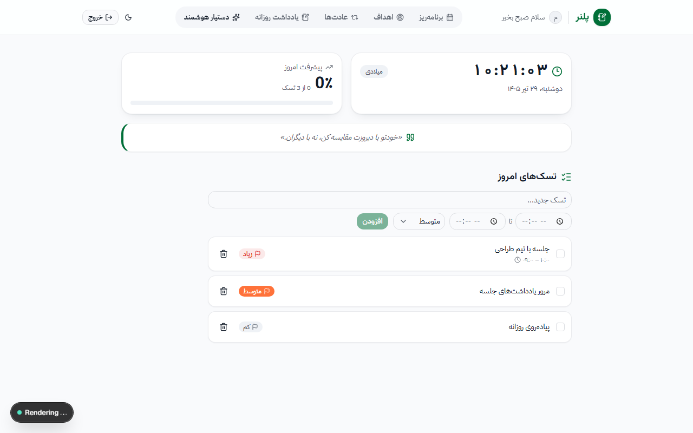

# پلنر — دیجیتال پلنر شخصی فارسی

> **English summary**
>
> A full-stack personal planner for Persian speakers, built end to end and running in production: daily/weekly/monthly planning on a full Jalali (Persian) calendar, goals, habit tracking, journaling, and an AI assistant that works with the user's real data.
>
> **Live demo:** [planner-vmdv-eight.vercel.app](https://planner-vmdv-eight.vercel.app) · **Stack:** Next.js 16 (App Router), TypeScript, PostgreSQL + Prisma, Tailwind CSS, Groq LLM API with tool calling, Web Push, Vercel
>
> **Technical highlights**
> - **AI assistant with tool calling** — it reads the user's real tasks, goals and habits, can create or edit them, and asks for confirmation before applying a suggested schedule. It also does web search (Tavily) and voice input.
> - **Model fallback** — if the current Groq model is retired or rate-limited, requests automatically move to the next model, so the assistant stays up.
> - **Real push reminders** — server-sent Web Push (VAPID) 10 minutes before each task, even when the app is closed, driven by a cron endpoint.
> - **Auto-rescheduling** — unfinished tasks move to the next day every night and are marked as rescheduled.
> - **Installable PWA** with an offline shell and an update prompt after each deploy.
> - **Custom auth** — JWT sessions (jose) without NextAuth, password reset by time-limited email link, and an admin panel.

یه پلنر دیجیتال شخصی، الهام‌گرفته از دفترچه‌های پلنر کاغذی: تسک روزانه/هفتگی/ماهانه با تقویم شمسی، اهداف، ردیاب عادت، یادداشت روزانه، و یه دستیار هوش مصنوعی که کارها رو برات مدیریت می‌کنه.

🔗 **دمو زنده:** [planner-vmdv-eight.vercel.app](https://planner-vmdv-eight.vercel.app)



## امکانات

- **برنامه‌ریزی روزانه/هفتگی/ماهانه** با تقویم شمسی کامل، اولویت‌بندی رنگی، بازه زمانی برای هر تسک، و جابه‌جایی تسک بین روزها با کشیدن-و-رهاکردن
- **جابه‌جایی خودکار تسک‌های انجام‌نشده** — هر تسکی که تا آخر روز تیک نخورده باشه، خودکار به روز بعد منتقل می‌شه (و اگر بازم انجام نشه، همین‌طور روز به روز جلو می‌ره) و با رنگ زرد به‌عنوان «جابه‌جا‌شده» مشخص می‌شه
- **اهداف** کوتاه‌مدت و بلندمدت با پیگیری درصد پیشرفت
- **ردیاب عادت** هفتگی با گرید چک‌باکسی
- **یادداشت روزانه** همراه با ثبت حالت روحی
- **دستیار هوش مصنوعی** (Groq) که با شناخت از اهداف/عادت‌ها/برنامه‌ی واقعی کاربر صحبت می‌کنه، می‌تونه تسک/هدف/عادت بسازه یا تغییر بده، برای بازه‌های زمانی خالی برنامه پیشنهاد بده (با تأیید کاربر قبل از اعمال)، جستجوی وب انجام بده، و از طریق صدا هم قابل استفاده‌ست
- **یادآوری واقعی با Web Push** — حتی وقتی اپ بسته باشه، ۱۰ دقیقه قبل از هر تسک نوتیفیکیشن می‌فرسته
- **پنل مدیریت** برای دیدن و مدیریت کاربران ثبت‌نامی
- **فراموشی رمز عبور** با تأیید مالکیت ایمیل (لینک بازیابی زمان‌دار)
- **PWA** کامل — قابل نصب روی موبایل/دسکتاپ، پوسته آفلاین
- حالت روشن/تاریک

## اسکرین‌شات‌ها

| داشبورد | برنامه‌ریز هفتگی |
|---|---|
|  |  |

| اهداف | عادت‌ها |
|---|---|
|  |  |

| دستیار هوش مصنوعی |
|---|
|  |

## پشته فنی

| بخش | تکنولوژی |
|---|---|
| فریم‌ورک | [Next.js 16](https://nextjs.org) (App Router, Turbopack), TypeScript |
| ظاهر | Tailwind CSS v4, کامپوننت‌های shadcn-style روی [Base UI](https://base-ui.com) |
| دیتابیس/ORM | PostgreSQL ([Neon](https://neon.tech)) + [Prisma 7](https://www.prisma.io) |
| احراز هویت | سشن سفارشی با JWT ([jose](https://github.com/panva/jose)) — بدون NextAuth |
| هوش مصنوعی | [Groq API](https://groq.com) (مدل `openai/gpt-oss-120b`) با tool calling و سوئیچ خودکار به مدل جایگزین، جستجوی وب با [Tavily](https://tavily.com) |
| ایمیل | Nodemailer روی Gmail SMTP |
| نوتیفیکیشن | Web Push API + [web-push](https://github.com/web-push-libs/web-push) با کلیدهای VAPID |
| تقویم شمسی | [jalaali-js](https://github.com/jalaali/jalaali-js) |
| میزبانی | [Vercel](https://vercel.com) |

## اجرای محلی

```bash
npm install
cp .env.example .env   # مقادیر واقعی رو پر کن
npx prisma migrate dev
npm run dev
```

متغیرهای محیطی لازم:

```
DATABASE_URL=              # اتصال Postgres (مثلاً از Neon)
SESSION_SECRET=            # یه رشته تصادفی برای امضای سشن
GROQ_API_KEY=              # کلید رایگان از console.groq.com
GROQ_MODEL=                # اختیاری؛ پیش‌فرض openai/gpt-oss-120b
TAVILY_API_KEY=            # اختیاری؛ برای جستجوی وب دستیار (tavily.com)
GMAIL_USER=                # ایمیل جیمیل برای ارسال لینک بازیابی رمز
GMAIL_APP_PASSWORD=        # App Password جیمیل (نه رمز اصلی حساب)
NEXT_PUBLIC_VAPID_PUBLIC_KEY=
VAPID_PRIVATE_KEY=         # با web-push.generateVAPIDKeys() ساخته می‌شه
VAPID_SUBJECT=             # مثلاً mailto:you@example.com
CRON_SECRET=               # هر رشته تصادفی، برای محافظت از مسیرهای /api/cron/*
```

دو تا Cron لازمه که از بیرون صدا زده بشن — چون سرورلس Vercel به‌تنهایی زمان‌بند لحظه‌ای نداره:

- `/api/cron/reminders` — هر ۱ دقیقه، برای یادآوری تسک‌ها
- `/api/cron/reschedule` — یه‌بار در روز (کمی بعد از نیمه‌شب ایران)، برای جابه‌جایی خودکار تسک‌های انجام‌نشده به روز بعد

هر دو مسیر با هدر `Authorization: Bearer <CRON_SECRET>` (یا کوئری `?secret=`) محافظت می‌شن. در این پروژه با GitHub Actions (`.github/workflows/reminders.yml` و `.github/workflows/reschedule.yml`) صدا زده می‌شن؛ یه سرویس رایگان زمان‌بند بیرونی مثل [cron-job.org](https://cron-job.org) هم جایگزین می‌شه.
